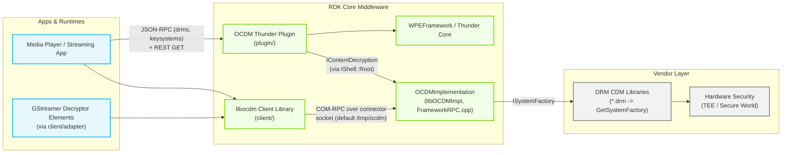
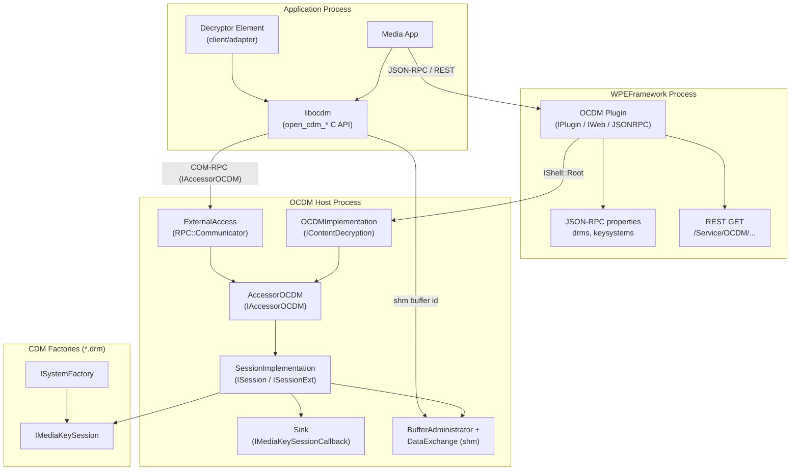
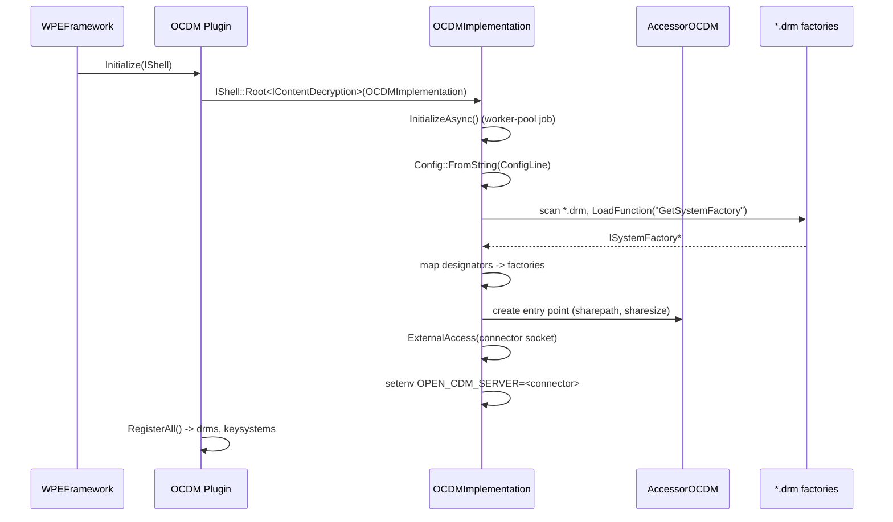
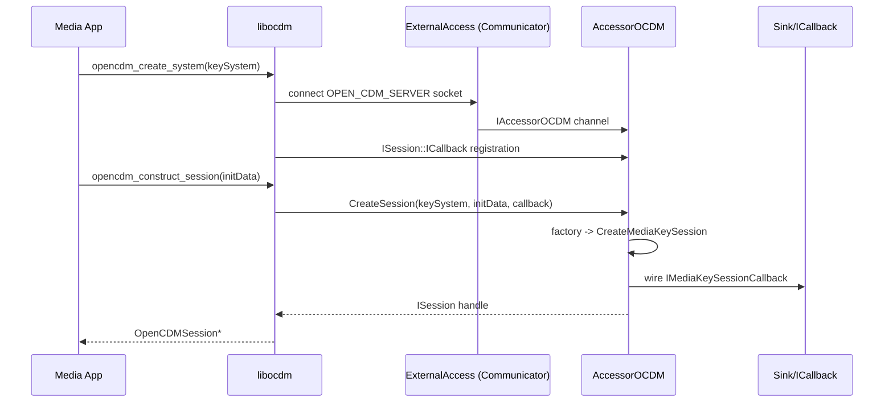
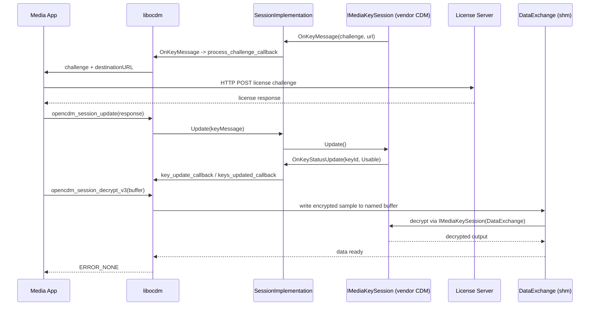

# entservices-opencdmi

The `entservices-opencdmi` repository provides the OpenCDMi (Open Content Decryption Module interface) service for RDK middleware. It is composed of two cooperating deliverables: a WPEFramework/Thunder plugin that hosts DRM session management behind the `Exchange::IContentDecryption` COM-RPC interface, and `libocdm`, a C client library that media applications and GStreamer decryptor elements link against to reach that service. The component encapsulates DRM system enumeration, key-session lifecycle, license challenge delivery, per-key status reporting, and a shared-memory media data path between decrypting applications and the server-side CDM.

The service is a bridge, not a DRM implementation: it loads vendor-supplied CDM factories (`*.drm` shared libraries exporting `GetSystemFactory`) at startup and routes sessions to the matching key system, so PlayReady, Widevine, ClearKey, FairPlay, Nagra, and other DRM stacks plug in behind one uniform API.

**Key Features & Responsibilities:**

- **DRM System Enumeration**: Discovers installed CDM factories by scanning the plugin data path for `*.drm` libraries at startup, loads each library's `GetSystemFactory` entry point, and maps configured *designators* (e.g. `com.microsoft.playready`, `org.w3.clearkey`) to factories. Exposes the result via the `drms` and `keysystems` JSON-RPC properties and the REST GET interface.

- **Key Session Management**: `AccessorOCDM` creates and owns `SessionImplementation` objects, each wrapping a `CDMi::IMediaKeySession`. Sessions support `Load`, `Update`, `Remove`, `Close`, `ResetOutputProtection`, `SetParameter`, `SelectKeyId`, `CleanDecryptContext`, and `Revoke`, with per-key-id status tracking driven by parsed CENC init data.

- **License Acquisition Callbacks**: CDM-originated events are forwarded through the `Sink` (`CDMi::IMediaKeySessionCallback`) to `Exchange::ISession::ICallback` — `OnKeyMessage` (license challenge + destination URL), `OnError` (error code + message), `OnKeyStatusUpdate` (per-key status change), and `OnKeyStatusesUpdated`.

- **Shared-Memory Data Path**: Each session can create a named `DataExchange` buffer (`Exchange::DataExchange` running on its own `Core::Thread`) under the configured `sharepath`/`sharesize`, letting encrypted samples and decrypted output cross the process boundary without socket copies. A `BufferAdministrator` administers buffer allocation under `_adminLock`.

- **Out-of-Process Service**: `OCDMImplementation` runs inside a dedicated RPC host process. It exposes `AccessorOCDM` over an `RPC::Communicator` (`ExternalAccess`) bound to the `connector` socket (default `/tmp/ocdm`) and publishes `OPEN_CDM_SERVER=<connector>` so libocdm clients can locate it. Crash of the remote connection triggers a `DEACTIVATED` job via `OCDM::Deactivated`.

- **Capability and Robustness Queries**: `IContentDecryption` surfaces `Systems()`, `Designators()`, `Sessions()`, `GetSupportedRobustness()` (via the `CDMi::IRobustnessExtension`), `Metadata()`, and per-system metrics (`Metricdata` via `CDMi::IMediaSystemMetrics`).

- **CENC Metadata Parsing**: `CENCParser`/`CommonEncryptionData` parses Common Encryption init data to extract key IDs, track per-key `KeyStatus`, and match sessions to key systems.

- **Client Library and Adapters**: `libocdm` (`client/open_cdm*.cpp`) exports the standard `opencdm_*` C API. The `client/adapter/gstreamer` and `client/adapter/rdk` adapters integrate it with GStreamer decryptor elements and RDK-specific decryption flows.

---

## Design

The design separates the thin plugin shell from the functional implementation. `plugin/OCDM.cpp` is a standard Thunder plugin (`IPlugin` + `IWeb` + `JSONRPC`); on `Initialize()` it resolves `Exchange::IContentDecryption` through `PluginHost::IShell::Root<>`, which instantiates `OCDMImplementation` (compiled as `libOCDMImpl.so`) — normally in a separate proxy-stub host process. The implementation then spins up `ExternalAccess`, an `RPC::Communicator` on the connector socket, so external `libocdm` clients reach `AccessorOCDM` independently of the plugin's own JSON-RPC channel. This yields two entry surfaces: JSON-RPC/REST for management-style queries, and COM-RPC + shared memory for the high-throughput decryption path.

### Threading Model

- **Threading Architecture**: Multi-threaded; three distinct thread domains — the Thunder worker pool, the RPC invoke engine, and per-session data-exchange threads.
- **Main / Caller Thread**: Plugin callbacks (`Initialize`, `Deinitialize`, `Process`) run on Thunder's control thread; COM-RPC requests are dispatched on `Core::IWorkerPool` threads via the `RPC::InvokeServer` engine.
- **Worker Threads**:
  - _`AsyncInitThread`_: A `Core::WorkerPool` job that runs `OCDMImplementation::InitializeAsync()` — scanning `*.drm` libraries, building the designator-to-factory map, creating the `AccessorOCDM` entry point, and starting `ExternalAccess` — so plugin activation is not blocked by CDM loading.
  - _`DataExchange` threads_: Each session's shared-memory exchange object derives from `Core::Thread` and pumps buffer state between the client mapping and the server-side `IMediaKeySession`.
  - _Deactivation job_: `OCDM::Deactivated` submits a `PluginHost::IShell::Job` (`DEACTIVATED`/`FAILURE`) onto the worker pool when the remote RPC connection dies.
- **Synchronization**: `_adminLock` guards `AccessorOCDM`'s session and buffer administration; `CommonEncryptionData` maintains per-key status atomically within the session; the `Sink` forwards CDM callbacks onto the `Exchange::ISession::ICallback` registered by the client.
- **Async / Event Dispatch**: Key-session events originate inside the vendor CDM, surface through `IMediaKeySessionCallback` (`Sink`), and are delivered to the client process over the COM-RPC session channel — no polling loops are used.

### Prerequisites and Dependencies

- **WPEFramework**: Thunder core with `PluginHost`, `RPC::Communicator`, proxy-stub support, and `JsonData_OCDM` generated types (`find_package(${NAMESPACE}Plugins)`).
- **Build Dependencies**: `ocdm` package (interface headers `IDRM.h`, `IContentDecryption.h`), `CompileSettingsDebug`.
- **Runtime Dependencies**: One or more `*.drm` CDM factory libraries installed under the plugin data path (`config.Location`), each exporting `GetSystemFactory()` returning a `CDMi::ISystemFactory`.
- **Device Services / HAL**: None directly; secure hardware interaction is delegated to the vendor CDM and its TEE binding.
- **Configuration Files**: Thunder plugin config generated from `plugin/OCDM.config` / `OCDM.conf.in` (autostart, preconditions, locator, mode, `sharepath`, `systems` array); implementation JSON keys `location`, `connector`, `sharepath`, `sharesize`, `systems`.
- **Startup Order**: `autostart` defaults to `true`; `preconditions` always include `Provisioning` and add `Platform` when Nexus/PlayReady-SVP/Nagra/Generic variants are enabled; `PLUGIN_OCDM_STARTUPORDER` optionally overrides the activation order.

---

### Component State Flow

#### Initialization to Active State

When Thunder activates the plugin, `OCDM::Initialize` resolves the `IContentDecryption` root object (spawning or attaching the OCDM host process), registers its JSON-RPC properties, and calls `IContentDecryption::Initialize`. Inside the implementation, `InitializeAsync` (submitted as a worker-pool job) parses the JSON config, loads `*.drm` factories, binds designators, creates `AccessorOCDM`, and opens `ExternalAccess` on the connector socket — at which point libocdm clients can connect.

#### Runtime State Changes

Sessions are created on demand by `AccessorOCDM::CreateSession`: the factory for the request's key system builds a `CDMi::IMediaKeySession`, wrapped by `SessionImplementation` and paired with a `Sink` callback. Key state is held in the session's `CommonEncryptionData` (per-key-id `KeyStatus`); the public `KeyStatus` enum values are `Usable`, `Expired`, `Released`, `OutputRestricted`, `OutputRestrictedHDCP22`, `OutputDownscaled`, `StatusPending`, `InternalError`, `HWError`.

**State Change Triggers:**

- `Update(keyMessage)` feeds a license response back into the CDM session, driving key-status transitions that surface as `OnKeyStatusUpdate`.
- `Load()` reactivates a persisted session; `Remove()` destroys its persistent state; `Close()` marks the session closed; `Revoke(callback)` detaches the client callback before teardown.
- `ResetOutputProtection()` clears the CDM output-protection context; `SelectKeyId`/`CleanDecryptContext` manage the ext-interface decrypt context.
- Remote-connection loss (`Deactivated`) pushes the plugin to `DEACTIVATED`/`FAILURE`, tearing the service down.

**Context Switching Scenarios:**

- The `mode` plugin option controls whether the implementation is hosted in-process or in a remote/container process; `PLUGIN_OPENCDMI_OOP` and optional `user`/`group` configure containerized execution.
- Multiple applications may hold concurrent libocdm connections; each receives its own `IAccessorOCDM` channel and independent sessions.
- `ISessionExt`/`IMediaKeySessionExt`/`IMediaKeySessionBatch` extension paths are negotiated with `dynamic_cast`, so sessions expose only the capabilities their CDM actually implements.

---

### Call Flows

#### Initialization Call Flow

#### License Acquisition and Decrypt Flow

---

## Internal Modules

| Module / Class | Description | Key Files |
|---|---|---|
| `OCDM` (plugin) | Thunder plugin shell. Implements `PluginHost::IPlugin`, `PluginHost::IWeb`, `PluginHost::JSONRPC`; resolves `IContentDecryption` via `IShell::Root`, serves REST GET endpoints (`drms`/`keysystems` properties), watches remote-connection death via `Deactivated`. | `plugin/OCDM.cpp`, `plugin/OCDM.h`, `plugin/OCDMJsonRpc.cpp` |
| `OCDMImplementation` | COM-RPC `IContentDecryption` service. Loads `*.drm` factories, maps designators, owns `ExternalAccess` communicator and `AccessorOCDM` entry point. | `plugin/FrameworkRPC.cpp` |
| `ExternalAccess` | `RPC::Communicator` bound to the `connector` node id, publishing `IAccessorOCDM` to libocdm clients and serving invocations on the `RPC::InvokeServer` engine. | `plugin/FrameworkRPC.cpp` |
| `AccessorOCDM` | Session factory/owner implementing `Exchange::IAccessorOCDM`. Handles `CreateSession`, `Systems`, `Designators`, `Sessions`, `Metricdata`, `GetSupportedRobustness`, movie-session and device-certificate extension methods. | `plugin/FrameworkRPC.cpp` |
| `SessionImplementation` | Per-session `Exchange::ISession` + `Exchange::ISessionExt` wrapper around `CDMi::IMediaKeySession`; owns `CommonEncryptionData` key-status state and the session `DataExchange` buffer. | `plugin/FrameworkRPC.cpp` |
| `Sink` | `CDMi::IMediaKeySessionCallback` adapter forwarding `OnKeyMessage`, `OnError`, `OnKeyStatusUpdate`, and `OnKeyStatusesUpdated` to the registered `Exchange::ISession::ICallback`. | `plugin/FrameworkRPC.cpp` |
| `DataExchange` / `BufferAdministrator` | Named shared-memory buffer per session (`Exchange::DataExchange` + `Core::Thread`) administered under `_adminLock`, using `sharepath`/`sharesize` config. | `plugin/FrameworkRPC.cpp` |
| `CENCParser` / `CommonEncryptionData` | Parses CENC init data into key-id sets and tracks per-key `KeyStatus` used by `Status()`/`HasKeyId()`. | `plugin/CENCParser.cpp`, `plugin/CENCParser.h`, `plugin/Protobuf.h` |
| `Config` / `Systems` | JSON config container for `location`, `connector`, `sharepath`, `sharesize`, and the `systems` array (`name`, `designators`, `configuration`, `blacklistedcodecregexps`, `blacklistedmediatyperegexps`). | `plugin/FrameworkRPC.cpp` |
| `AsyncInitThread` | Worker-pool job running `InitializeAsync` so plugin activation is not blocked by CDM factory loading. | `plugin/FrameworkRPC.cpp` |
| `GoogleCastAuthExtensionProxy` | Optional `IGoogleCastAuthExtension` proxy for Cast-auth key systems. | `plugin/FrameworkRPC.cpp` |
| `MemoryObserver` | `Exchange::IMemory` implementation reporting resident/allocated/shared memory of the remote host process. | `plugin/OCDM.cpp` |
| libocdm client | C client library exporting the `opencdm_*` API (34 functions) with session callback registration and decrypt variants (`_v2`, `_fps`, `_v3`). | `client/open_cdm.cpp`, `client/open_cdm_impl.cpp`, `client/open_cdm_ext.cpp` |
| `CapsParser` | Parses capability/description strings used by the client-side system negotiation. | `client/CapsParser.cpp`, `client/CapsParser.h` |
| GStreamer / RDK adapters | Integration layers between libocdm and GStreamer decryptor elements / RDK decrypt paths. | `client/adapter/gstreamer/open_cdm_adapter.cpp`, `client/adapter/rdk/open_cdm_adapter.cpp`, `client/adapter/rdk/open_cdm_decrypt.cpp` |
| Plugin helpers | JSON-RPC utilities and plugin interface scaffolding shared with other entservices plugins. | `helpers/PluginInterfaceBuilder.h`, `helpers/UtilsJsonRpc.h`, `helpers/UtilsLogging.h` |

---

## Component Interactions

### Interaction Matrix

| Target Component / Layer | Interaction Purpose | Key APIs / Topics |
|---|---|---|
| **RDK Middleware Components** | | |
| WPEFramework / Thunder | Plugin lifecycle, COM-RPC channel, JSON-RPC registration, remote-connection notification | `PluginHost::IShell::Root<Exchange::IContentDecryption>`, `RegisterAll()`, `Deactivated()` |
| libocdm consumers (apps, decryptors) | DRM session operations, license callbacks, shared-memory decryption | `IAccessorOCDM`, `ISession`, `ISessionExt`, `Exchange::DataExchange` |
| **Device Services / HAL** | | |
| Vendor `*.drm` CDM factories | DRM system capability and session execution | `GetSystemFactory()`, `CDMi::ISystemFactory`, `CDMi::IMediaKeySession`, `IMediaKeySessionExt`, `IMediaKeySessionBatch` |
| **External Systems** | | |
| License server (application-owned) | HTTP license challenge/response exchange | `OnKeyMessage` challenge + destinationURL; `Update(keyMessage)` |

### JSON-RPC / REST Surface

| API | Type | Description |
|---|---|---|
| `drms` | JSON-RPC property (read-only) | Array of `DrmData { name, keysystems[] }` — installed DRM systems and their designators |
| `keysystems` | JSON-RPC property (read-only) | Designator strings for a named DRM system (`ERROR_BAD_REQUEST` for unknown DRM) |
| `GET /Service/OCDM/` | REST | JSON list of systems and designators |
| `GET /Service/OCDM/Designators/<system>` | REST | Designators for the requested system |
| `GET /Service/OCDM/Sessions` | REST | Stub endpoint — returns `Active Sessions` without a payload |

### Events Published

| Event | Channel | Trigger Condition | Subscriber |
|---|---|---|---|
| License challenge | `ISession::ICallback::OnKeyMessage` -> `process_challenge_callback` | CDM generates a license request challenge with destination URL | libocdm client / application |
| Key status change | `ISession::ICallback::OnKeyStatusUpdate` -> `key_update_callback` | CDM reports a per-key-id `KeyStatus` transition | libocdm client / application |
| Key-status batch complete | `ISession::ICallback::OnKeyStatusesUpdated` -> `keys_updated_callback` | CDM finished a status update batch | libocdm client / application |
| Session error | `ISession::ICallback::OnError` -> `error_message_callback` | CDM raises an error (numeric code + message) | libocdm client / application |
| Connection loss | `OCDM::Deactivated` -> `IShell::Job` | Remote OCDM host process dies | WPEFramework plugin host |

### IPC Flow Patterns

**Session creation and license acquisition** — see the license-acquisition diagram above. The key boundary: license-server exchange is performed by the *application* inside the registered challenge callback; the plugin/CDM only produces and consumes challenge/response payloads.

**Shared-memory decrypt path:** the client calls a decrypt variant on `libocdm`; the session's `DataExchange` object transfers the sample through the named shared buffer to the server-side `IMediaKeySession`, avoiding a socket copy of the media payload.

---

## Implementation Details

### Major APIs Integration

| API | Purpose | Implementation File |
|---|---|---|
| `opencdm_create_system()` / `opencdm_create_system_extended()` | Connect to the OCDM service for a key system | `client/open_cdm.cpp`, `client/open_cdm_impl.cpp` |
| `opencdm_construct_session()` | Create an `OpenCDMSession` with init data + callbacks | `client/open_cdm.cpp` |
| `opencdm_session_update()` | Deliver a license response into the session | `client/open_cdm.cpp` |
| `opencdm_session_decrypt()` / `_v2` / `_fps` / `_v3` | Decrypt a sample through the session buffer | `client/open_cdm.cpp`, `client/open_cdm_ext.cpp` |
| `opencdm_session_load()` / `_remove()` / `_close()` | Persist, purge, and close sessions | `client/open_cdm.cpp` |
| `opencdm_is_type_supported()` / `opencdm_system_get_metadata()` / `opencdm_system_get_drm_time()` | System capability and metadata queries | `client/open_cdm.cpp` |
| `IContentDecryption::Initialize()` | Implementation-side init (factories + communicator) | `plugin/FrameworkRPC.cpp` |
| `IAccessorOCDM::CreateSession()` | Server-side session creation with callback wiring | `plugin/FrameworkRPC.cpp` |
| `ISession::Load()` / `Update()` / `Remove()` / `Close()` / `Revoke()` | Session lifecycle over COM-RPC | `plugin/FrameworkRPC.cpp` |
| `ISessionExt::SelectKeyId()` / `CleanDecryptContext()` | Extended decrypt-context control | `plugin/FrameworkRPC.cpp` |

### Key Implementation Logic

- **State / Lifecycle Management**: Plugin state is Thunder-managed (`SERVICE_REGISTRATION` version 1.0.4). Session state lives in `SessionImplementation::_cencData` (`CommonEncryptionData`), which tracks each key id's `KeyStatus`; `SessionId()`/`BufferId()`/`BufferIdExt()` expose stable identifiers, and `Revoke(callback)` detaches the client callback during teardown.

- **Event Processing**: CDM callbacks funnel through the `Sink` into `Exchange::ISession::ICallback` over the COM-RPC session channel. Key-id bookkeeping (`UpdateKeyStatus`) runs inside `CommonEncryptionData` so `Status()` always reflects the latest CDM-reported per-key state.

- **Error Handling Strategy**: OpenCDM calls return `OpenCDMError` (`ERROR_NONE`, `ERROR_UNKNOWN`, `ERROR_KEYSYSTEM_NOT_SUPPORTED`, `ERROR_INVALID_SESSION`, `ERROR_OUT_OF_MEMORY`, `ERROR_METHOD_NOT_IMPLEMENTED`, `ERROR_SERVER_*`, ...); COM-RPC methods return `Exchange::OCDM_RESULT` (`OCDM_SUCCESS`, `OCDM_S_FALSE`, `OCDM_KEYSYSTEM_NOT_SUPPORTED`, `OCDM_INTERFACE_NOT_IMPLEMENTED`). Unsupported extension paths degrade gracefully via `dynamic_cast` checks.

- **Logging & Diagnostics**: `TRACE(Trace::Information/Error/Fatal, ...)` throughout `FrameworkRPC.cpp` and `OCDM.cpp`; `SYSLOG(Logging::Startup, ...)` for factory-load failures; `UtilsLogging.h` helpers for the helpers layer.

- **Extension Points**: Optional CDM capabilities are negotiated by `dynamic_cast` — `IMediaKeySessionExt` (`SelectKeyId`, `CleanDecryptContext`), `IMediaKeySessionBatch`, `IMediaSessionMetrics` (`Metricdata`), robustness reporting (`GetSupportedRobustness`), and `IGoogleCastAuthExtension` for Cast authentication.

- **Config-Driven Codec Filtering**: Per-system `blacklistedcodecregexps` and `blacklistedmediatyperegexps` in the `systems` JSON array filter advertised codec/media-type support per key system.

---

## Configuration

Runtime behavior is driven by three mechanisms:

- **Thunder plugin configuration**: generated by `plugin/OCDM.config` / `OCDM.conf.in` — `autostart`, `preconditions`, `startuporder`, `locator` (`lib${PLUGIN_OCDM_IMPLEMENTATION}.so`), `mode`, `outofprocess`, optional `user`/`group`, `sharepath`, and the `systems` array.
- **Implementation JSON config** (parsed by `Config::FromString` of the plugin config line):

| Key | Type | Default | Purpose |
|---|---|---|---|
| `location` | string | (unset — relative to plugin `DataPath`) | Subdirectory scanned for `*.drm` CDM factory libraries |
| `connector` | string | `/tmp/ocdm` | Unix socket path for `ExternalAccess` (exported as `OPEN_CDM_SERVER`) |
| `sharepath` | string | `/tmp` | Directory for named `DataExchange` session buffers |
| `sharesize` | uint | `8192` (8 * 1024) | Shared-buffer size unit passed to `AccessorOCDM` |
| `systems` | array | `[]` | Key-system entries: `name`, `designators`, `configuration`, `blacklistedcodecregexps`, `blacklistedmediatyperegexps` |

- **Build-time CMake flags** (from `plugin/CMakeLists.txt`, `services.cmake`, `OCDM.config`/`OCDM.conf.in`):

| CMake Flag | Description | Source |
|---|---|---|
| `PLUGIN_OPENCDMI_AUTOSTART` | Auto-activate the plugin at Thunder startup (default `true`) | `plugin/CMakeLists.txt` |
| `PLUGIN_OPENCDMI_MODE` | Plugin run mode (default `Local`; `Off` forces in-process and clears OOP) | `plugin/CMakeLists.txt` |
| `PLUGIN_OCDM_STARTUPORDER` | Optional startup-order override for plugin activation | `plugin/CMakeLists.txt` |
| `PLUGIN_OCDM_IMPLEMENTATION` | Implementation library name (default `${MODULE_NAME}Impl`) | `plugin/CMakeLists.txt` |
| `PLUGIN_OPENCDMI_OOP` | Configure out-of-process hosting for the implementation | `plugin/OCDM.conf.in` |
| `PLUGIN_OPENCDMI_USER` / `PLUGIN_OPENCDMI_GROUP` | Optional uid/gid for a containerized implementation process | `plugin/OCDM.config` |
| `PLUGIN_OPENCDMI_CLEARKEY` | Adds `ClearKey` system (`org.chromium.externalclearkey`, `org.w3.clearkey`) | `plugin/OCDM.conf.in` |
| `PLUGIN_OPENCDMI_FAIRPLAY` | Adds `CFairPlay` system (`com.apple.fps`) | `plugin/OCDM.conf.in` |
| `PLUGIN_OPENCDMI_PLAYREADY` (+ `_NEXUS`, `_NEXUS_SVP`, `_VGDRM`, `_CERTIFICATE_LABEL`, `_METERING_CERTIFICATE`) | PlayReady variants and certificate material | `plugin/OCDM.conf.in` |
| `PLUGIN_OPENCDMI_WIDEVINE` (+ `_DEVICE_CERTIFICATE`, `_KEYBOX`, `_STORAGE_LOCATION`) | Widevine system and credential paths | `plugin/OCDM.conf.in` |
| `PLUGIN_OPENCDMI_NAGRA` / `PLUGIN_OPENCDMI_NCAS` / `PLUGIN_OPENCDMI_GENERIC` | Nagra / NCAS / generic CDM variants (add `Platform` precondition where applicable) | `plugin/OCDM.conf.in` |
| `COMCAST_CONFIG` | Comcast services configuration (default `ON`) | root `CMakeLists.txt` |
| `USE_THUNDER_R4` | Selects Thunder R4 API surface (`IMemory::IsOperational` signature, proxy-stub behavior) | `plugin/OCDM.cpp` |
